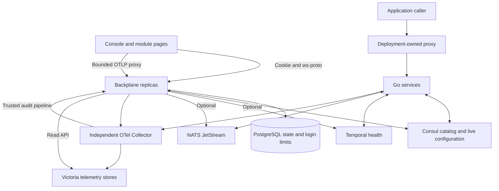

# Architecture

Backplane has three cooperating surfaces: a service SDK, an installation control plane and a browser console. The SDK announces service capabilities. The control plane stores operator intent and reconciles it with the installation. The console reads those contracts and provides both administration and module pages.

## Ownership

| Owner | Responsible for |
| --- | --- |
| Service author | Domain behavior, payloads, schemas, activities, hooks, events, workflows, public APIs, module pages |
| Platform | Discovery, versioned intent, reconciliation, API authentication, control audit, console host |
| Deployment | Processes and containers, credentials, TLS, routing boundaries, enabled runtimes, Collector pipelines, retention and storage capacity |
| Operator | Live configuration, investigation |

Services are independently built. Each product owns its inter-service protocols. Adding a product method does not change the platform API.

## Control plane and data plane

PostgreSQL stores authoritative control state and audit. Consul supplies registration, health and the distributed configuration view used by services. Reconciliation bridges committed operator intent and runtime state; UI status distinguishes a saved revision from one applied by an instance.

External publication and routing belong to deployment; application requests reach the services' own public listeners. The console's authenticated internal API relay is a separate path. The server proxies module assets so embedded modules load from the console origin; it does not build or deploy those modules.

NATS and Temporal endpoints, when configured on the platform server, are probed for availability. Working traffic stays between the application and its chosen infrastructure.

## Independent telemetry

The Collector and Victoria stores form an independently managed OTel deployment. Backplane forwards admitted OTLP requests and queries configured stores. It does not reinterpret each telemetry point or maintain a second telemetry database. Audit is a deliberate exception: control and trusted application audit are durable records in PostgreSQL.

## Identity and versions

Service names identify contract owners. Instances identify running processes. A versioned manifest describes configuration, console API ownership, UI and telemetry selectors. Build identity is stamped into the service binary; its version must change when its manifest changes. Versions with build metadata follow the same immutability rule. A conflicting manifest stops startup rather than letting a new process run under old declarations.

Current and historical manifests can coexist during rolling updates. The catalog prefers the highest version with a registered, healthy instance in the serving phase. A starting, unhealthy or stopping newer replica does not replace a working older version in the console. If no version is available, known declarations remain visible for offline inspection, and plugins are marked unavailable. Stopping a service does not delete its historical manifest. See [availability](../deploying/availability.md).
