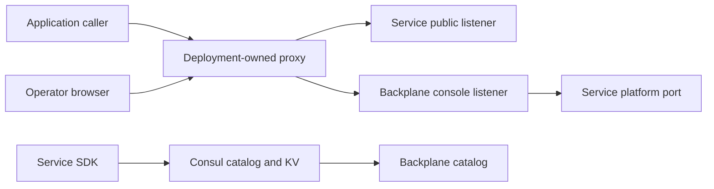

# External routing and service discovery

External routing belongs to deployment. Backplane and its SDK do not configure
proxies, supply xDS/EDS, publish routes or choose external URLs. The platform does
not require a particular gateway.

## Who configures what

The service author chooses protocols, handlers, local paths, ports and application
middleware. The operator configures domains, published paths, rewrites, authentication
and upstream discovery in the deployment's proxy or Kubernetes gateway.
TLS terminates in deployment before traffic reaches the application's HTTP listener.

In Kubernetes, target the application's Kubernetes Service with the gateway already
used by the installation. In Compose, use container DNS names and the service ports.
Consul service discovery can also be used independently by infrastructure. Backplane
reading the Consul catalog for console operations does not configure that discovery.

## Console behind a reverse proxy

Forward the console listener (default `8081`) with WebSocket upgrades enabled.
Preserve the path including `BACKPLANE_CONSOLE_PREFIX`, such as `/backplane`.
Preserve Host and configure allowed origins when the browser's origin differs.
Set `BACKPLANE_CONSOLE_TRUSTED_PROXIES` only to addresses/CIDRs of actual trusted proxies.
Keep secure cookies enabled for HTTPS deployments; insecure cookies are a local HTTP option.

The proxy only needs to expose the console listener to serve the shell, session API,
WebSocket API, module assets and API schema files. The console fetches module assets
and calls internal APIs using service platform addresses, independently of the proxy.
Do not publish platform ports as application endpoints.

## API metadata

`Manifest.apis` describes what a service serves and supplies documents for the API
viewer. It is not a desired proxy configuration. Declaring an API does not make it
externally reachable, and the console does not claim that publication was applied.

## Local development

`make dev` exposes the console at `http://127.0.0.1:8081/backplane/`, hello at
`http://127.0.0.1:8080/hello/`, its independently served example at
`http://127.0.0.1:8083/legacy/`, and formatter at `http://127.0.0.1:8082/formatter/`.
The standard stack runs without an external gateway.
