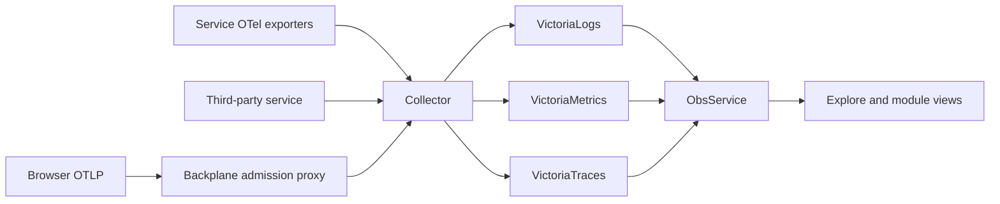

# Logs, metrics and traces

Backplane queries an independently deployed telemetry stack. Services and external applications can emit ordinary OpenTelemetry without declaring a module. The platform's optional OTLP proxy performs bounded admission and forwarding; the Collector performs processing and export.



## Trace sampling

A service on the SDK records every span by default
(`BACKPLANE_TELEMETRY_TRACES_SAMPLER=always_on`), whatever the caller's
trace flags say: an unsampled parent from a client or a proxy does not drop
the service's spans. Which traces are kept is the Collector's decision (tail
sampling sees whole traces). The other samplers are OpenTelemetry's:
`always_off`, `traceidratio` and the parent-based `parentbased_always_on`,
`parentbased_always_off`, `parentbased_traceidratio`, the ratio ones taking
`BACKPLANE_TELEMETRY_TRACES_RATIO` (0..1). `OTEL_TRACES_SAMPLER` does not
apply to SDK services.

## Metric export and histograms

Every service on the SDK exports Go runtime and process metrics and its own
instruments without code of its own. Two settings shape them; both are fixed
at start.

**Export interval.** `OTEL_METRIC_EXPORT_INTERVAL` / `OTEL_METRIC_EXPORT_TIMEOUT`
(milliseconds, the OpenTelemetry standard) apply as they are; without them a
point every 30 s. `BACKPLANE_TELEMETRY_METRICS_INTERVAL` / `_TIMEOUT` (`5s`)
override both for one service.

**Histograms.** A duration in seconds (`unit: s`) gets buckets from 5 ms to
10 s, one in milliseconds (`ms`) the same in ms: OpenTelemetry's own defaults
(0 to 10000) are made for milliseconds and turn every quantile in seconds
into noise. Rules change that per instrument, first match wins, ahead of the
built-in ones:

```yaml
backplane:
  telemetry:
    metrics:
      histograms:
        # Precise quantiles at any scale: exponential buckets that follow the data.
        - {instrument: "templates.*", aggregation: exponential, max_size: 80}
        # Fixed buckets of your own.
        - {instrument: courier.delivery.duration, boundaries: [0.05, 0.1, 0.5, 1, 5, 30]}
        # Not exported at all.
        - {instrument: "db.client.*", aggregation: drop}
        # What the instrument asks for itself (its boundaries advice).
        - {instrument: own.histogram, aggregation: default}
        # Every other duration: exponential.
        - {instrument: "*", unit: s, aggregation: exponential}
```

As an environment variable the list is JSON:
`BACKPLANE_TELEMETRY_METRICS_HISTOGRAMS='[{"instrument":"*","unit":"s","aggregation":"exponential"}]'`.

| field | meaning |
|---|---|
| `instrument` | name; `*` and `?` are wildcards |
| `unit` | the histogram's unit must be this (`s`, `ms`, `By`); empty: any |
| `aggregation` | `explicit` (default), `exponential`, `drop`, `default` |
| `boundaries` | explicit: bucket upper bounds, strictly increasing |
| `max_size`, `max_scale` | exponential: most buckets per sign (160), finest scale −10…20 (20) |
| `no_min_max` | leave min and max out |

Explicit or exponential:

- **Explicit** buckets are cheap and portable: one series per bound. A
  quantile is interpolated inside a bucket, so it is only as good as the
  bounds around it (a value of 0.1 ms in a 0–5 ms bucket reads as up to 4.75 ms).
- **Exponential** buckets follow the data and give precise quantiles at any
  scale, for more series: VictoriaMetrics stores them as `vmrange` buckets,
  as many as the values span (`max_size` bounds them; fewer is coarser).

Explore reads both: quantiles group by `le` and `vmrange`. Histograms of
different buckets do not add up, so a quantile without a grouping is taken
per service. Durations show in their unit (µs, ms, s) on tiles, axes and in
the legend.

## Sources without declarations

Discovery reads stored resource identity: `service.namespace`, `service.name` and `service.instance.id`. Missing fields remain missing. A third-party identity server and its wrapper can both appear even if only the wrapper registers with Backplane.

An author may provide related presets:

```go
svc.TelemetrySources(
    map[string]string{"service.namespace": "identity", "service.name": "wrapper"},
    map[string]string{"service.namespace": "identity", "service.name": "kratos"},
)
```

Maps are OR alternatives, with exact AND matches inside each. Deployment overrides take precedence over declarations; absent declarations fall back to the service-name convention. Explicit empty selectors disable presets. None of this restricts ingestion or global discovery. Namespaces are organization, not tenant authorization.

## Query languages

| Signal | Language and behavior |
| --- | --- |
| Logs | LogsQL, including statistics queries |
| Metrics | MetricsQL and compatible PromQL; instant or range query |
| Raw spans | LogsQL against the traces backend |
| Trace search | TraceQL only when deployment advertises support |

The pinned VictoriaTraces profile supports basic TraceQL search, not full Tempo parity or TraceQL metrics. Read `GetObsCapabilities` before offering language choices. The API passes native expressions to the selected backend; it does not translate languages.

## Explore

Choose signal and time range, then source/field filters or a native expression. The builder rewrites the expression, which remains editable. A metrics view initially offers a generated dashboard; selecting a panel opens its query. Logs provide volume, lines and a detail drawer. Trace results open a span tree, timing ruler, attributes, events, links and related logs.

Query bounds use exact nanoseconds. Backend samples and large integers remain exact text where appropriate. A truncated/partial result is labeled; narrow the query or range before concluding that missing data never existed.

## Deployment bounds

Each query has timeout, concurrency, response-size, expression, range and result limits. Backends need their own execution/memory budgets as well. Overload is an explicit error, not an empty success. A store outage fails queries without making the whole platform unready.

OTLP admission separately limits compressed and decoded size, active requests and source rate. Collector transformations, redaction, persistent queues, storage retention and credentials remain deployment configuration. See [OTLP reference](../reference/otlp.md) and [read API](../reference/observability-api.md).
